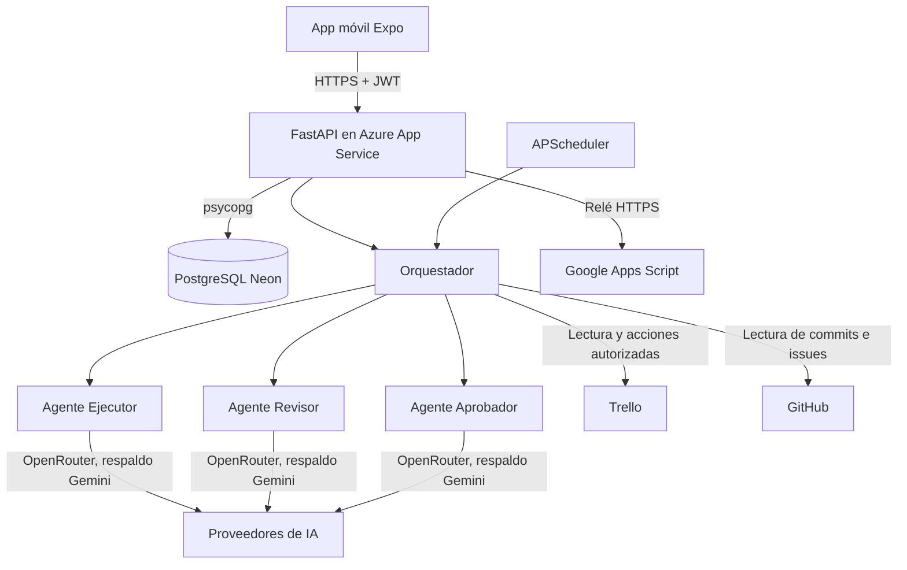

# Agente de Proyectos 🤖

[](https://www.python.org/)
[](https://fastapi.tiangolo.com/)
[](https://www.postgresql.org/)
[](https://reactnative.dev/)
[](https://expo.dev/)
[](https://www.typescriptlang.org/)
[](https://azure.microsoft.com/products/app-service)

Agente de Proyectos es un sistema multiagente de seguimiento y control de proyectos de software. Un **Agente Ejecutor**
analiza el tablero de **Trello** y el repositorio de **GitHub**, un **Agente Revisor** valida sus propuestas y un
**Agente Aprobador** aplica las políticas del equipo. La última decisión es siempre del gestor del proyecto, que
trabaja desde una **app móvil** (Android e iOS) y puede conversar con un asistente para preguntar por el estado del
proyecto.

---

## 🔗 Enlaces del Proyecto

*   **API del Servidor (Azure App Service):** [https://agente-proyectos.azurewebsites.net](https://agente-proyectos.azurewebsites.net) · estado en [`/health`](https://agente-proyectos.azurewebsites.net/health)
*   **Descarga de la Aplicación Móvil (Android e iOS):** [Descargar el último APK e IPA (Releases)](https://github.com/kiramman-mp3/agente-proyectos/releases)
*   **Repositorio:** [github.com/kiramman-mp3/agente-proyectos](https://github.com/kiramman-mp3/agente-proyectos)
*   **Documentación técnica:** carpeta [`docs/`](./docs/README.md)

---

## 📝 Descripción

Los equipos que gestionan sus actividades en Trello suelen enterarse tarde de los retrasos, de los bloqueos y de los
problemas de calidad del código. Agente de Proyectos automatiza esa vigilancia sin quitarle el control a las
personas: detecta actividades retrasadas, bloqueadas o en riesgo, estima su impacto sobre las actividades
dependientes, propone acciones correctivas y redacta el reporte semanal.

Ninguna acción se ejecuta sin pasar por el flujo **Ejecutor → Revisor → Aprobador → Gestor**. El código fuente
**nunca se modifica automáticamente**: los hallazgos graves se proponen como *issues* de GitHub que el gestor debe
aprobar. Todo queda registrado en una bitácora de auditoría con fecha, hora y actor.

---

## ✨ Características Principales

*   **Seguimiento de actividades:** estados (pendiente, en ejecución, completada, retrasada, bloqueada), avance ponderado, riesgos por vencimiento y por desfase entre avance y tiempo transcurrido, y dependencias entre tarjetas (`Depende de: …`).
*   **Flujo multiagente con control humano:** el Ejecutor propone de 1 a 3 alternativas por problema, el Revisor las valida con reglas automáticas e IA, el Aprobador aplica `policy.json` y el gestor aprueba, rechaza o solicita modificaciones desde la app.
*   **Revisión de código:** análisis de los últimos commits de GitHub con análisis estático y con IA según los estándares de `backend/standards.md`; el Revisor descarta falsos positivos.
*   **Reporte semanal automático:** cifras calculadas sin IA, redacción del Ejecutor y validación del Revisor.
*   **Asistente conversacional (solo lectura):** chat flotante en la app para preguntar «¿qué está retrasado?» o «¿qué propuestas esperan mi decisión?» con los datos ya sincronizados.
*   **Proveedor de IA con respaldo:** OpenRouter como principal y Gemini como respaldo automático si el principal falla por cuota, saturación o credencial ausente. Se pueden usar modelos gratuitos.
*   **Notificaciones y correo:** avisos en la app y correo a los gestores ante retrasos, bloqueos o fallos críticos.
*   **Seguridad:** credenciales cifradas con Fernet, contraseñas con PBKDF2-SHA256, sesiones JWT que se revocan al cambiar o restablecer la contraseña, límite de intentos de login, roles (gestor y desarrollador), contraseña temporal obligatoria de cambiar y decisiones del gestor atómicas (una acción nunca se ejecuta dos veces).
*   **App móvil adaptable:** tema claro y oscuro, interfaz que se centra en tablets y ventanas grandes y orientación libre.

---

## 🛠️ Tecnologías Utilizadas

### Backend
*   **Python 3.11** con **FastAPI** y **Uvicorn** (API REST)
*   **PostgreSQL** (Neon) en producción y **SQLite** en local, con `psycopg` y pool de conexiones
*   **Autenticación:** JWT (`PyJWT`) y hashing PBKDF2-SHA256
*   **Cifrado de credenciales:** `cryptography` (Fernet)
*   **Planificador:** `APScheduler` (análisis de retrasos, revisión de código y reporte semanal)
*   **IA:** OpenRouter y API de Gemini (ambas compatibles con OpenAI) vía `httpx`
*   **Pruebas:** `pytest` (41 pruebas)

### Aplicación Móvil
*   **React Native** y **Expo 57** con **TypeScript**
*   **Expo Router** (navegación basada en archivos)
*   **Expo SecureStore** (sesión y usuario recordado en el almacenamiento seguro del teléfono)
*   **Jest** (`jest-expo`) para las pruebas, ESLint y TypeScript en modo estricto
*   **Schibsted Grotesk** (`@expo-google-fonts`) como tipografía de la app
*   **EAS Build** para generar el APK de Android y el IPA sin firmar para iOS

### Infraestructura
*   **Azure App Service** (Linux, plan B1, Python 3.11, Always On, solo HTTPS)
*   **GitHub Actions** (CI de backend y app; despliegue opcional a Azure)
*   **Neon** (PostgreSQL gestionado)
*   **Google Apps Script** como relé HTTPS de correo

---

## 🏗️ Arquitectura del Sistema



El detalle de cada pieza, el modelo de datos y el flujo de una propuesta están en
[`docs/arquitectura.md`](./docs/arquitectura.md) y [`docs/flujo-multiagente.md`](./docs/flujo-multiagente.md).

---

## 📂 Estructura del Proyecto

```text
agente-proyectos/
├── backend/                   # API REST y agentes (FastAPI)
│   ├── app/
│   │   ├── agents/            # Ejecutor, Revisor y Aprobador
│   │   ├── integrations/      # Clientes de Trello y GitHub
│   │   ├── main.py            # Endpoints REST
│   │   ├── orchestrator.py    # Flujo multiagente, decisiones del gestor, reportes
│   │   ├── tracking.py        # Estados, avance, riesgos y dependencias (sin IA)
│   │   ├── actions.py         # Único módulo que escribe en Trello/GitHub
│   │   ├── chat.py            # Asistente conversacional de solo lectura
│   │   ├── llm.py             # Cliente de IA con proveedor de respaldo
│   │   ├── security.py        # Cifrado, contraseñas, JWT y roles
│   │   ├── scheduler.py       # Tareas automáticas
│   │   ├── mailer.py          # Correo a los gestores
│   │   └── db.py              # Esquema y acceso a SQLite/PostgreSQL
│   ├── deploy/                # Relé de correo (Google Apps Script)
│   ├── tests/                 # Pruebas con pytest
│   ├── policy.json            # Reglas de autorización del Aprobador
│   └── standards.md           # Estándares de código para la revisión
├── mobile/                    # App Expo / React Native
│   ├── src/
│   │   ├── app/               # Pantallas (Expo Router): pestañas, chat, login…
│   │   ├── components/        # Componentes de interfaz
│   │   └── lib/               # Cliente de la API, sesión y tema
│   ├── assets/                # Ícono y recursos
│   ├── app.json               # Configuración de Expo
│   └── eas.json               # Perfiles de compilación (APK e IPA)
└── docs/                      # Documentación técnica
```

---

## ⚙️ Requisitos Previos

*   [Python](https://www.python.org/) 3.10 o superior (el despliegue usa 3.11)
*   [Node.js](https://nodejs.org/) 18 o superior y npm
*   [Git](https://git-scm.com/)
*   Una cuenta de Trello con una clave de API y un token, y un token de GitHub (Contents: lectura, Issues: lectura y escritura)
*   Una clave de [OpenRouter](https://openrouter.ai/keys) o de [Gemini](https://aistudio.google.com/apikey)
*   Para generar los instaladores: una cuenta gratuita en [expo.dev](https://expo.dev)

---

## 🚀 Instalación y Despliegue Local

### 1. Clonar el Repositorio
```bash
git clone https://github.com/kiramman-mp3/agente-proyectos.git
cd agente-proyectos
```

### 2. Levantar el Backend
```powershell
cd backend
python -m venv .venv
.venv\Scripts\activate
pip install -r requirements.txt
copy .env.example .env
python -m app.cli gen-key          # copia la clave generada en MASTER_KEY dentro de .env
```

Completa `.env` (ver la tabla de variables más abajo) y guarda las credenciales **cifradas**; se piden sin mostrarse
y no quedan en ningún archivo de texto:

```powershell
python -m app.cli set-secret openrouter_api_key   # o gemini_api_key, según LLM_PROVIDER
python -m app.cli set-secret trello_api_key
python -m app.cli set-secret trello_token
python -m app.cli set-secret github_token
python -m app.cli create-user gestor1 gestor
python -m app.cli check                           # prueba Trello, GitHub y los modelos de IA
uvicorn app.main:app --host 0.0.0.0 --port 8000
```

Para ver la documentación interactiva de la API en local, agrega `ENABLE_DOCS=true` al `.env`: queda en
`http://localhost:8000/docs`. En producción está desactivada.

### 3. Levantar la App Móvil
```bash
cd mobile
npm install
npx expo start
```

Escanea el código QR con Expo Go, o usa `npm run android` con un emulador. La app apunta por defecto al backend de
Azure; para usar tu backend local cambia `SERVER_URL` en `mobile/src/lib/api.ts`
(consulta [`docs/app-movil.md`](./docs/app-movil.md)).

### 4. Generar los Instaladores
```bash
cd mobile
npx eas-cli@latest login
npx eas-cli@latest build -p android --profile preview        # APK
npx eas-cli@latest build -p ios --profile ios-altstore       # IPA sin firmar (AltStore)
```

---

## 🔒 Variables de Entorno

Las más importantes del backend (la lista completa está en [`docs/configuracion.md`](./docs/configuracion.md)):

| Variable | Descripción | Valor por Defecto |
|---|---|---|
| `MASTER_KEY` | Clave Fernet que cifra las credenciales guardadas | *(Requerida; `python -m app.cli gen-key`)* |
| `JWT_SECRET` | Secreto para firmar los tokens de sesión | *(Requerida)* |
| `DATABASE_URL` | URL de PostgreSQL (Neon). Vacío: SQLite local | *(vacío)* |
| `LLM_PROVIDER` | Proveedor de IA principal: `openrouter` o `gemini` | `openrouter` |
| `MODEL_EXECUTOR`, `MODEL_REVIEWER`, `MODEL_APPROVER` | Modelo de cada agente | `anthropic/claude-sonnet-4.5`, `openai/gpt-4.1-mini` |
| `LLM_FALLBACK_PROVIDER` | Proveedor de respaldo si el principal falla | *(vacío: sin respaldo)* |
| `FALLBACK_MODEL_EXECUTOR`, `FALLBACK_MODEL_REVIEWER`, `FALLBACK_MODEL_APPROVER` | Modelos del proveedor de respaldo | *(vacío)* |
| `TRELLO_BOARD_ID` | Identificador del tablero (`trello.com/b/<ID>/…`) | *(Requerida)* |
| `GITHUB_REPO` / `GITHUB_BRANCH` | Repositorio (`usuario/repo`) y rama a revisar | *(Requerida)* / `main` |
| `TIMEZONE` | Zona horaria de los reportes y tareas | `America/Guayaquil` |
| `MAIL_TRANSPORT` | `smtp`, `apps_script` o vacío (sin correo) | *(vacío)* |
| `ENABLE_DOCS` | Publica `/docs` y `/openapi.json` (solo para desarrollo) | `false` |
| `LOGIN_MAX_ATTEMPTS` / `LOGIN_WINDOW_SECONDS` | Intentos fallidos de login permitidos por usuario y ventana de tiempo | `5` / `900` |
| `ANALYSIS_INTERVAL_MINUTES` | Cada cuántos minutos se analizan los retrasos | `60` |
| `CODE_REVIEW_INTERVAL_HOURS` | Cada cuántas horas se revisa el código | `24` |
| `REPORT_DAY` / `REPORT_HOUR` | Día y hora del reporte semanal | `mon` / `8` |

---

## 💻 Uso y Scripts Disponibles

### Backend (`/backend`)
*   `uvicorn app.main:app --host 0.0.0.0 --port 8000`: inicia la API.
*   `pytest`: ejecuta las pruebas (instala antes `pip install -r requirements-dev.txt`).
*   `python -m app.cli check`: prueba las conexiones con Trello, GitHub y los tres modelos.
*   `python -m app.cli run analisis|codigo|reporte|sync`: ejecuta un proceso manualmente.
*   `python -m app.cli secrets | set-secret | create-user | set-password | gen-key`: administración de credenciales y usuarios.

### Móvil (`/mobile`)
*   `npm start`: inicia Expo (Metro).
*   `npm run android` / `npm run ios`: abre la app en un emulador o dispositivo.
*   `npm run typecheck`, `npm run lint` y `npm test`: tipos, ESLint y pruebas con Jest.
*   `npm run build:apk`: genera el APK con EAS.

---

## 🗺️ Roadmap de Desarrollo

### Funcionalidades Completadas ✅
*   [x] Seguimiento de actividades de Trello con estados, avance, riesgos y dependencias.
*   [x] Flujo Ejecutor → Revisor → Aprobador → Gestor con política configurable.
*   [x] Revisión de código con análisis estático y con IA, sin modificar nunca el código.
*   [x] Reporte semanal automático.
*   [x] Bitácora de auditoría, notificaciones en la app y correo a los gestores.
*   [x] Gestión de usuarios y roles desde la app, con contraseña temporal.
*   [x] Base de datos persistente en PostgreSQL (Neon).
*   [x] Backend en Azure App Service con Always On.
*   [x] Rediseño de la app, ícono propio y diseño adaptable a tablet.
*   [x] Asistente conversacional de solo lectura con botón flotante.
*   [x] Proveedor de IA de respaldo automático.
*   [x] Endurecimiento: límite de intentos de login, sesiones revocables, solo HTTPS, decisiones atómicas, `/docs` desactivado en producción y comentarios automáticos saneados.
*   [x] Purga automática de datos antiguos y tareas programadas seguras con varias instancias.
*   [x] Integración continua (pytest, tipos, lint y Jest) y flujo opcional de despliegue a Azure.

### Mejoras Futuras 🚀
*   [ ] Guardar el historial del chat entre sesiones.
*   [ ] Que el asistente pueda proponer acciones (siempre con aprobación del gestor).
*   [ ] Notificaciones push en el teléfono.
*   [ ] Actualizar a Expo SDK 58 para cerrar las vulnerabilidades que quedan en herramientas de compilación.
*   [ ] Soporte para más gestores de tareas además de Trello.

---

## 📚 Documentación

| Documento | Contenido |
|---|---|
| [`docs/arquitectura.md`](./docs/arquitectura.md) | Componentes, modelo de datos y decisiones de diseño |
| [`docs/flujo-multiagente.md`](./docs/flujo-multiagente.md) | Cómo viaja una propuesta, política y convenciones de Trello |
| [`docs/api.md`](./docs/api.md) | Referencia de los endpoints REST y sus permisos |
| [`docs/configuracion.md`](./docs/configuracion.md) | Variables de entorno, credenciales y proveedores de IA |
| [`docs/despliegue-azure.md`](./docs/despliegue-azure.md) | Cómo está desplegado el backend y cómo actualizarlo |
| [`docs/app-movil.md`](./docs/app-movil.md) | Pantallas, desarrollo, diseño y generación de APK e IPA |
| [`docs/asistente-chat.md`](./docs/asistente-chat.md) | Cómo funciona el chatbot y sus límites |
| [`docs/seguridad.md`](./docs/seguridad.md) | Roles, cifrado, sesiones y manejo de secretos |
| [`docs/desarrollo.md`](./docs/desarrollo.md) | Pruebas, flujo de ramas y convenciones |
| [`docs/solucion-de-problemas.md`](./docs/solucion-de-problemas.md) | Errores frecuentes y cómo resolverlos |
| [`docs/requerimientos.md`](./docs/requerimientos.md) | Matriz de requerimientos con su evidencia |

---

## 👥 Contribuidores

| Nombre | Commits |
|---|---|
| Johan Rodríguez ([@kiramman-mp3](https://github.com/kiramman-mp3)) | 17 |

---

## 📄 Licencia

Este proyecto está bajo la Licencia MIT. Para más detalles, consulta el archivo [LICENSE](./LICENSE).

---

## 👤 Autores

*   **Johan Rodríguez** ([@kiramman-mp3](https://github.com/kiramman-mp3))
