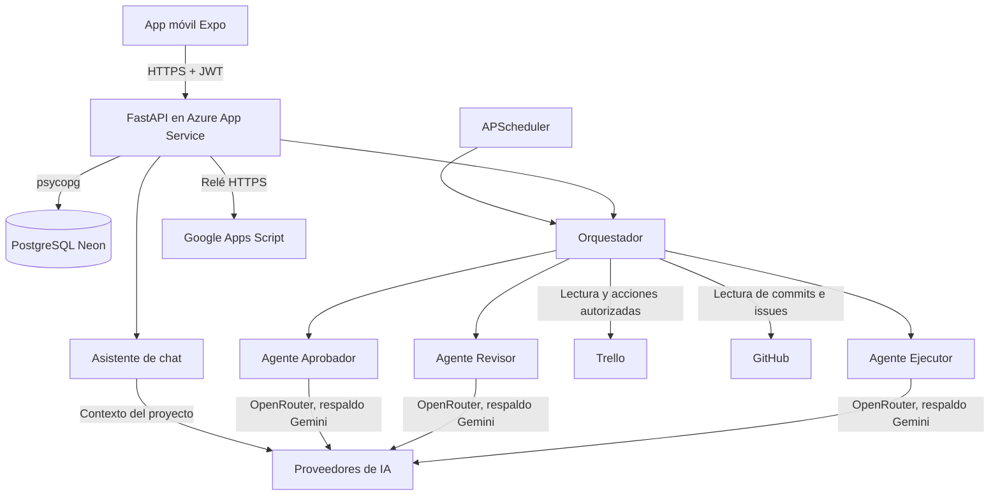

# Arquitectura

## Visión general

El sistema es una aplicación cliente-servidor. La app móvil habla con una API REST (FastAPI) mediante HTTPS y un
token JWT. La API orquesta tres agentes de IA, lee y escribe en Trello y GitHub, guarda su estado en PostgreSQL y
avisa por correo a los gestores.

## Componentes del backend

| Módulo | Responsabilidad |
|---|---|
| `backend/app/main.py` | Endpoints REST, validación de entrada y permisos por rol |
| `backend/app/orchestrator.py` | Sincronización con Trello, flujo multiagente de cada propuesta, decisiones del gestor, revisión de código y reporte semanal |
| `backend/app/tracking.py` | Lógica **determinista, sin IA**: estados, avance, riesgo, dependencias y diferencias entre sincronizaciones |
| `backend/app/agents/executor.py` | Agente Ejecutor: analiza causas, propone alternativas, redacta reportes y revisa código |
| `backend/app/agents/reviewer.py` | Agente Revisor: validaciones automáticas y verificación técnica con IA |
| `backend/app/agents/approver.py` | Agente Aprobador: aplica `policy.json` y evalúa el riesgo |
| `backend/app/actions.py` | **Único** módulo que escribe en Trello o GitHub, y solo con propuestas autorizadas |
| `backend/app/integrations/` | Clientes HTTP de Trello y GitHub |
| `backend/app/code_analysis.py` | Análisis estático de los cambios de código |
| `backend/app/chat.py` | Asistente conversacional de solo lectura (ver [asistente-chat.md](./asistente-chat.md)) |
| `backend/app/llm.py` | Cliente de IA (OpenRouter y Gemini) con reintentos y proveedor de respaldo |
| `backend/app/security.py` | Cifrado Fernet, contraseñas PBKDF2, JWT y roles |
| `backend/app/scheduler.py` | Tareas automáticas con APScheduler |
| `backend/app/mailer.py` | Correo a los gestores por SMTP o por relé HTTPS |
| `backend/app/audit.py` | Bitácora de auditoría |
| `backend/app/bootstrap.py` | En cada arranque, cifra las credenciales recibidas por entorno y asegura el usuario inicial |
| `backend/app/db.py` | Esquema y acceso a datos; SQLite en local y PostgreSQL con `DATABASE_URL` |

## Modelo de datos

Las tablas se crean al arrancar (`backend/app/db.py`).

| Tabla | Contenido |
|---|---|
| `users` | Usuarios, rol, hash de contraseña y marca de cambio obligatorio de contraseña |
| `secrets` | Credenciales de terceros cifradas con Fernet |
| `kv` | Pares clave-valor: actividades sincronizadas, resumen, metadatos del tablero y última sincronización |
| `board_snapshots` | Copias del tablero para detectar cambios |
| `plan_changes` | Cambios detectados entre dos sincronizaciones |
| `proposals` | Propuestas correctivas con el veredicto de cada etapa y la decisión del gestor |
| `audit_log` | Bitácora: quién hizo qué y cuándo (agente, humano o sistema) |
| `reports` | Reportes semanales (cifras y contenido en Markdown) |
| `code_reviews` | Revisiones de código con hallazgos |
| `notifications` | Avisos mostrados en la app |

## Tareas automáticas

El planificador se inicia con la API y ejecuta, en la zona horaria `TIMEZONE`:

| Tarea | Frecuencia | Variable |
|---|---|---|
| Análisis de retrasos | Cada `ANALYSIS_INTERVAL_MINUTES` (60 por defecto) | `ANALYSIS_INTERVAL_MINUTES` |
| Revisión de código | Cada `CODE_REVIEW_INTERVAL_HOURS` (24 por defecto) | `CODE_REVIEW_INTERVAL_HOURS` |
| Reporte semanal | Un día y hora fijos (lunes a las 8 por defecto) | `REPORT_DAY`, `REPORT_HOUR` |

Cada proceso tiene un bloqueo propio para no ejecutarse dos veces a la vez. Con `SCHEDULER_ENABLED=false` no se
programa nada (así corren las pruebas).

## Decisiones de diseño

*   **Lo determinista va sin IA.** Estados, avance, riesgo y cifras del reporte se calculan con código. La IA solo
    interpreta causas, redacta y valida; así los números del reporte no dependen de un modelo.
*   **Escritura en un solo lugar.** `actions.py` concentra todo lo que modifica Trello o GitHub, lo que facilita auditar
    qué puede hacer el sistema.
*   **El código nunca se modifica.** `policy.json` prohíbe modificar código, hacer commit o push; los hallazgos
    graves se convierten en *issues* que el gestor aprueba.
*   **Tres agentes con modelos independientes.** Cada rol puede usar un modelo distinto, y el Revisor puede
    descartar lo que proponga el Ejecutor.
*   **Proveedor de IA intercambiable.** OpenRouter y Gemini comparten el formato de la API de OpenAI, y un
    proveedor de respaldo cubre los fallos del principal.
*   **Estado fuera del servidor.** La base vive en Neon, por lo que reiniciar o redesplegar el backend no pierde
    propuestas, reportes ni usuarios.
*   **Chat de solo lectura.** El asistente no tiene herramientas: recibe un resumen de los datos y solo responde.
