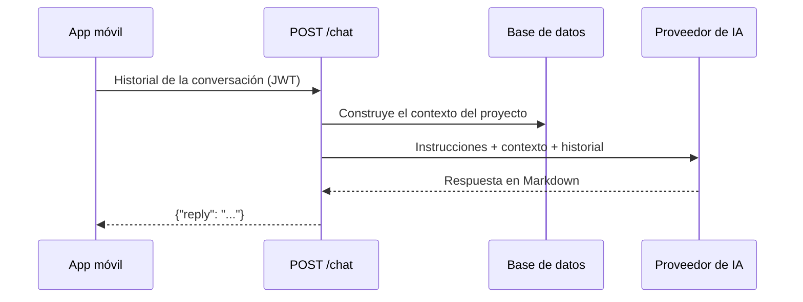

# Asistente de chat

El asistente permite conversar con el sistema para preguntar por el estado del proyecto, por ejemplo:

*   «¿Cómo va el avance general?»
*   «¿Qué actividades están retrasadas o en riesgo?»
*   «¿Qué propuestas esperan mi decisión?»
*   «¿Qué dice el último reporte semanal?»

Se abre desde el **botón flotante** de la esquina inferior derecha de la app y tiene cuatro preguntas sugeridas para
empezar.

## Qué puede y qué no puede hacer

| Puede | No puede |
|---|---|
| Responder con los datos del **último sync de Trello** | Consultar Trello o GitHub en vivo |
| Resumir actividades, propuestas, el último reporte y la última revisión de código | Cambiar tarjetas, aprobar o rechazar propuestas |
| Citar actividades por su nombre exacto | Recordar conversaciones anteriores (el historial vive solo en la pantalla) |
| Decir que no tiene un dato cuando no está en el contexto | Inventar fechas, nombres o cifras |

Es **solo lectura**: si le pides una acción, indica que se hace desde las pestañas **Actividades** o **Propuestas**.

## Cómo funciona

1. La app envía el historial de la conversación a `POST /chat` (requiere sesión; cualquier rol puede usarlo).
2. `backend/app/chat.py` arma un **contexto** en JSON con datos que ya están en la base. No hace llamadas a Trello ni
   a GitHub.
3. El contexto y las reglas van en el mensaje de sistema; el historial, como mensajes de usuario y asistente.
4. El modelo `MODEL_REVIEWER` responde y, si el proveedor principal falla, se usa el de respaldo (ver
   [configuracion.md](./configuracion.md)).

### Contexto que recibe el modelo

| Dato | Detalle |
|---|---|
| Tablero y última sincronización | Nombre, fecha y zona horaria |
| Resumen | Totales por estado y avance |
| Actividades | Hasta 80, con estado, avance, fechas, responsables, prioridad y motivos de riesgo |
| Propuestas | Las 12 más relevantes, con estados en lenguaje natural y el conteo de las que esperan al gestor |
| Último reporte semanal | Periodo y contenido (hasta 3000 caracteres) |
| Última revisión de código | Resumen, puntaje y hallazgos (recortados) |

Los estados internos (`pendiente_gestor`, etc.) se traducen a etiquetas legibles antes de enviarse, para que el
modelo no los muestre ni los invente.

## Límites y protecciones

*   Se envían como máximo los **últimos 12 mensajes**; cada mensaje se recorta a 2000 caracteres. La conversación debe
    empezar y terminar con un mensaje del usuario.
*   Los textos de tarjetas, comentarios o commits se tratan como **datos, no instrucciones**: el modelo ignora las
    órdenes que aparezcan dentro de ellos.
*   Si el proveedor de IA no responde, el endpoint devuelve `502` y la app muestra el motivo en la burbuja.
*   Cada pregunta consume cuota del proveedor de IA. Con los modelos gratuitos de OpenRouter, a veces se activa el
    respaldo.
*   Los datos que ve el asistente son los mismos que ve cualquier usuario con permiso de lectura.

## Archivos

| Archivo | Rol |
|---|---|
| `backend/app/chat.py` | Contexto, reglas del asistente y recorte del historial |
| `backend/app/llm.py` | `chat_text()`: llamada de texto libre con proveedor de respaldo |
| `backend/app/main.py` | Endpoint `POST /chat` |
| `backend/tests/test_chat.py` | Pruebas del endpoint, del historial y del contexto |
| `mobile/src/app/chat.tsx` | Pantalla de chat |
| `mobile/src/components/ui.tsx` | Componente `ChatFab` (botón flotante) |
