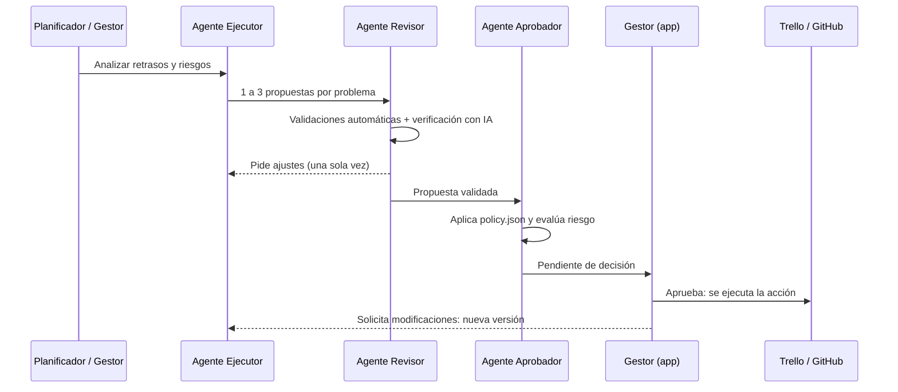

# Flujo multiagente

Ninguna acción sobre Trello o GitHub se ejecuta sin recorrer este flujo completo. Cada etapa deja un registro en la
bitácora.

## Etapas

1. **Ejecutor.** Sincroniza Trello, detecta actividades retrasadas, bloqueadas o en riesgo, analiza la causa y el
   impacto y propone de 1 a 3 alternativas correctivas por problema. Los tipos de acción son: reprogramar, cambiar
   prioridad, reasignar responsables, cambiar estado, comentar en la tarjeta y crear un *issue* en GitHub.
2. **Revisor.** Valida cada propuesta en dos pasos:
    *   *Automático:* la tarjeta existe, las fechas son futuras y coherentes, el miembro pertenece al tablero, la lista
        existe y no hay conflictos con dependencias.
    *   *Con IA:* verificación técnica. Si pide ajustes, el Ejecutor corrige la propuesta una vez.
3. **Aprobador.** Aplica `backend/policy.json`: deniega lo prohibido, escala las reprogramaciones grandes,
   autoejecuta solo las acciones de bajo impacto y envía el resto al gestor.
4. **Gestor.** Desde la pestaña **Propuestas** de la app aprueba, rechaza o **solicita modificaciones**. Si pide
   cambios, el Ejecutor genera una nueva versión que vuelve a pasar por el Revisor y el Aprobador.
5. **Ejecución.** Solo las propuestas autorizadas se aplican. Al ejecutar una alternativa, las demás alternativas
   del mismo problema se descartan.

## Estados de una propuesta

| Estado | Significado |
|---|---|
| `en_revision` | Los agentes están evaluándola |
| `rechazada_revisor` | El Revisor la rechazó |
| `denegada_aprobador` | El Aprobador la denegó por política o riesgo |
| `pendiente_gestor` | Espera la decisión del gestor |
| `aprobada` / `auto_aprobada` | Aprobada por el gestor o autorizada por política |
| `rechazada_gestor` | El gestor la rechazó |
| `modificacion_solicitada` | El gestor pidió cambios |
| `ejecutada` / `fallida` | Resultado de aplicar la acción |
| `descartada` | Otra alternativa del mismo problema se ejecutó |

## Política del Aprobador (`backend/policy.json`)

| Clave | Efecto | Valor actual |
|---|---|---|
| `acciones_permitidas` | Acciones que el sistema puede proponer | reprogramar, cambiar_prioridad, reasignar, cambiar_estado, comentar, crear_issue |
| `auto_ejecutables` | Acciones que se ejecutan sin el gestor (con riesgo bajo) | comentar |
| `auto_ejecucion_riesgo_maximo` | Riesgo máximo para autoejecutar | bajo |
| `prohibidas` | Acciones que se deniegan siempre | modificar_codigo, hacer_commit, hacer_push, eliminar_tarjeta, archivar_tarjeta |
| `escalar_si_reprogramacion_mayor_a_dias` | Una reprogramación mayor siempre pasa al gestor | 14 |
| `max_propuestas_por_analisis` | Tope de propuestas por ejecución | 10 |

## Revisión de código

`run_code_review` toma los últimos commits de la rama `GITHUB_BRANCH`, ejecuta el análisis estático
(`code_analysis.py`) y pide al Ejecutor que evalúe los cambios con los estándares de `backend/standards.md`. El
Revisor descarta los falsos positivos. Los hallazgos graves se convierten en una propuesta de tipo `crear_issue`,
que sigue el mismo flujo de aprobación. **Nunca se modifica el código.**

## Reporte semanal

`generate_weekly_report` calcula las cifras de la semana sin IA, el Ejecutor redacta la narrativa y el Revisor la
valida. El resultado queda en la pestaña **Reportes**.

## Convenciones en Trello

*   **Estado:** según la lista donde está la tarjeta. Es «completada» también si se marca la fecha como cumplida;
    «bloqueada» si está en la lista de bloqueados o tiene la etiqueta `Bloqueado`; «retrasada» si venció sin
    completarse. Los nombres de las listas se configuran con `LISTS_PENDING`, `LISTS_IN_PROGRESS`, `LISTS_DONE` y
    `LISTS_BLOCKED`.
*   **Prioridad:** etiquetas `Alta`, `Media` y `Baja` (configurables con `PRIORITY_LABELS`).
*   **Dependencias:** en la descripción de la tarjeta, una línea `Depende de: <nombre de tarjeta o shortLink>`. Se
    usan para calcular el impacto de un retraso sobre otras actividades.
*   **Avance:** completada = 100 %; si tiene checklist, el porcentaje de ítems marcados; en progreso sin checklist = 50 %.
*   **Riesgo:** una actividad está en riesgo si vence en `RISK_DAYS` días o menos (3 por defecto) o si el tiempo
    transcurrido supera al avance en más de 30 puntos porcentuales.
